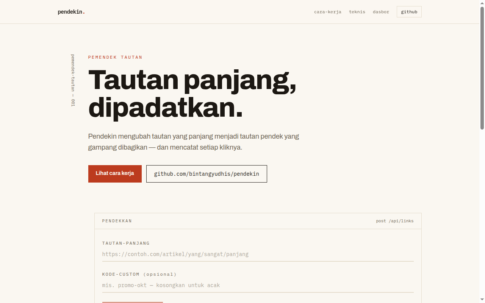

# Pendekin

Pendekin adalah aplikasi pemendek tautan. Pengguna menempelkan tautan panjang dan mendapat tautan pendek dengan slug acak atau slug pilihan sendiri. Setiap kunjungan ke tautan pendek dicatat dan ringkasannya tampil di dasbor pemilik.

Situs live: https://pendekin.bintangyudhis.my.id

## Fitur

- Pembuatan tautan pendek lewat `POST /api/links` dengan validasi URL tujuan. Skema `https://` boleh tidak ditulis.
- Slug custom 3 sampai 32 karakter berupa huruf, angka, tanda hubung, dan garis bawah.
- Redirect 308 ke tautan tujuan. Setiap kunjungan mencatat waktu, referer, dan user agent.
- Halaman 404 untuk kode yang tidak dikenal.
- Dasbor pemilik berisi daftar tautan, tombol salin, kode QR, statistik klik per tautan, dan grafik klik harian 14 hari.
- Tautan bisa dinonaktifkan dan dihapus dari dasbor.
- Proteksi dasbor memakai token pemilik yang dibaca dari environment server. Sesi disimpan sebagai cookie httpOnly berisi hash token selama 30 hari.
- Dasbor menolak akses bila token pemilik belum terkonfigurasi.
- Pembatasan jumlah pembuatan tautan per alamat IP untuk menekan penyalahgunaan.

## Teknologi

- Next.js 16 dan React 19 dengan App Router
- TypeScript
- Tailwind CSS v4
- Prisma 6 dan PostgreSQL dari Supabase lewat connection pooler
- Paket qrcode untuk membuat kode QR tautan

## Cara Instalasi

Prasyarat:

- Node.js 20 atau lebih baru
- Database PostgreSQL, misalnya project Supabase

Langkah instalasi:

```bash
git clone https://github.com/bintangyudhis/pendekin.git
cd pendekin
npm install
cp .env.example .env
```

Isi nilai variabel berikut di berkas `.env`:

- `DATABASE_URL`
- `DIRECT_URL`
- `PENDEKIN_OWNER_TOKEN`

Lalu jalankan migrasi database:

```bash
npx prisma migrate deploy
```

## Cara Menjalankan

Mode pengembangan:

```bash
npm run dev
```

Buka http://localhost:3000 di browser. Dasbor pemilik berada di http://localhost:3000/dasbor dan meminta token pemilik saat pertama kali dibuka.

Mode produksi:

```bash
npm run build
npm start
```

Perintah `npm run build` menjalankan migrasi database lebih dulu, lalu membangun aplikasi. Pemeriksaan kode memakai `npm run lint`.

## Tangkapan Layar



## Lisensi

Proyek ini memakai lisensi MIT. Lihat berkas [LICENSE](LICENSE).
